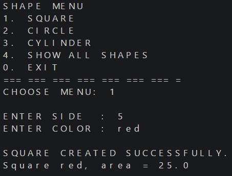
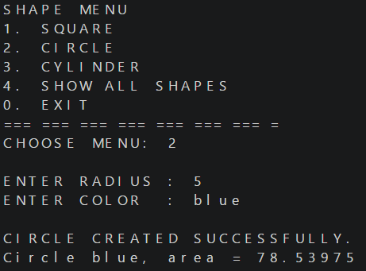
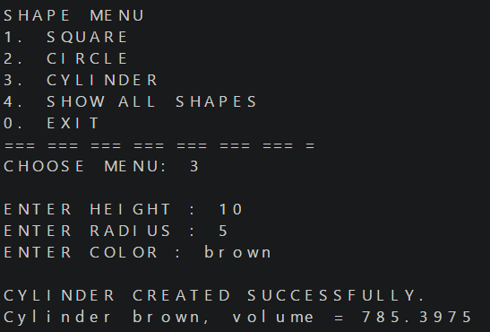
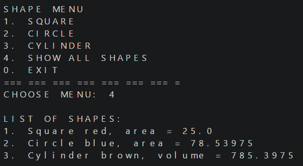

# Inheritance & Polymorphism (Tugas PBO)

## Project Structure

```
src/
├── Bentuk.java         (superclass)
├── BujurSangkar.java   (extends Bentuk)
├── Lingkaran.java      (extends Bentuk)
├── Silinder.java       (extends Lingkaran)
└── Main.java           (interactive menu and program entry point)
```

### Class Hierarchy

```
Bentuk
├── BujurSangkar
└── Lingkaran
└── Silinder
```

### Class Summary

| Class | Attributes | Main Methods |
|-------|-----------|--------------|
| `Bentuk` | `protected String warna` | `getWarna()`, `setWarna()`, `printInfo()` |
| `BujurSangkar` | `private double sisi` | `getSisi()`, `setSisi()`, `hitungLuas()`, `printInfo()` |
| `Lingkaran` | `private double radius`, `PHI` (`public static final double = 3.14159`) | `getRadius()`, `setRadius()`, `hitungLuas()`, `printInfo()` |
| `Silinder` | `private double tinggi` | `getTinggi()`, `setTinggi()`, `hitungVolume()`, `printInfo()` |

---

## Features

The program displays an interactive menu and stores every created shape in a single list (`ArrayList<Bentuk>`):

| Menu | Action |
|------|--------|
| 1 | Create a `BujurSangkar` / Square (side, color) |
| 2 | Create a `Lingkaran` / Circle (radius, color) |
| 3 | Create a `Silinder` / Cylinder (height, radius, color) |
| 4 | Show details of all shapes created so far |
| 0 | Exit |

---

## Concepts Used

### 1. Encapsulation
Data is hidden inside classes and accessed through specific methods:
- Attributes `sisi` in `BujurSangkar`, `radius` in `Lingkaran`, and `tinggi` in `Silinder` are **private**, accessed via getters and setters.
- The `warna` attribute in `Bentuk` is **protected** so that subclasses can access it directly.

### 2. Inheritance
Subclasses reuse attributes and methods from their superclass using the `extends` keyword:
- `BujurSangkar` and `Lingkaran` extend `Bentuk`, inheriting `warna` and passing it up using `super(warna)`.
- `Silinder` extends `Lingkaran` (**multilevel inheritance**), reusing `hitungLuas()` from `Lingkaran` to compute `hitungVolume()` (`hitungLuas() * tinggi`).

### 3. Polymorphism
Implemented via **Method Overriding**:
- The `printInfo()` method in `Bentuk` is overridden by `BujurSangkar`, `Lingkaran`, and `Silinder` to customize output formatting.
- Objects are stored in a generic `ArrayList<Bentuk>` list and invoked dynamically when displaying "Show all shapes".

---

## Screenshots

### 1. Square



### 2. Circle



### 3. Cylinder



### 4. Show All Shapes



---

## How to Run

Requires JDK 8 or newer.

```bash
# Compile all .java files into the bin folder
javac -d bin src/*.java

# Run the program from the bin folder
java -cp bin Main